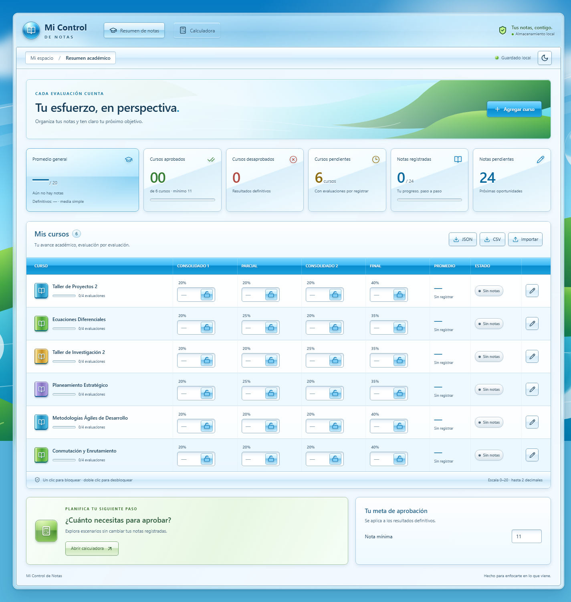
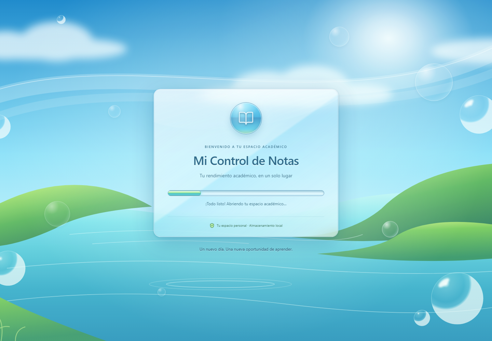

<div align="center">

# Mi Control de Notas

**Tu rendimiento académico, en un solo lugar.**

Aplicación local para registrar notas universitarias, calcular promedios y planificar tus próximas evaluaciones, con una interfaz inspirada en Windows Vista y Windows 7.

**React · TypeScript · Vite · Tailwind CSS · Dexie / IndexedDB**

Sin cuentas · Sin backend · Guardado automático · Estética Frutiger Aero

[Inicio rápido](#inicio-rápido) · [Funcionalidades](#funcionalidades) · [Respaldos](#respaldos-e-intercambio-de-datos) · [Pruebas](#pruebas-y-compilación)

</div>

## Vista previa



<details>
<summary><strong>Ver la pantalla de bienvenida</strong></summary>



</details>

_Capturas de un entorno de prueba con los cursos iniciales. Los datos que aparecen en tu navegador dependen de tus propios registros._

## Contenido

- [Qué puedes hacer](#qué-puedes-hacer)
- [Inicio rápido](#inicio-rápido)
- [Abrir con doble clic en Windows](#abrir-con-doble-clic-en-windows)
- [Funcionalidades](#funcionalidades)
- [Cómo se calculan las notas](#cómo-se-calculan-las-notas)
- [Cursos y ponderaciones iniciales](#cursos-y-ponderaciones-iniciales)
- [Respaldos e intercambio de datos](#respaldos-e-intercambio-de-datos)
- [Dónde se guardan los datos](#dónde-se-guardan-los-datos)
- [Tecnologías y estructura](#tecnologías-y-estructura)
- [Pruebas y compilación](#pruebas-y-compilación)
- [Preguntas frecuentes](#preguntas-frecuentes)
- [Documentación complementaria](#documentación-complementaria)

## Qué puedes hacer

| Función                     | Descripción                                                                     |
| --------------------------- | ------------------------------------------------------------------------------- |
| Registrar notas             | Cuatro evaluaciones por curso, con valores de 0 a 20 y hasta dos decimales.     |
| Proteger casillas           | Candados independientes: un clic para bloquear y doble clic para desbloquear.   |
| Consultar promedios         | Resultados definitivos, promedios provisionales y acumulados ponderados.        |
| Planificar evaluaciones     | Calculadora de notas necesarias con simulaciones que no cambian tus registros.  |
| Administrar cursos          | Agregar, renombrar, cambiar ponderaciones, restablecer notas y eliminar cursos. |
| Revisar tu avance           | Seis tarjetas estadísticas, estados académicos y progreso por curso.            |
| Conservar y trasladar datos | Guardado automático, respaldos JSON e informes CSV para Excel.                  |
| Personalizar la interfaz    | Temas Aero claro y nocturno; nota mínima aprobatoria configurable.              |

## Inicio rápido

### Requisitos

- **Node.js:** rama 22 desde la versión 22.12, rama 24 o versión 26 en adelante, según `package.json`.
- **npm** y un navegador con soporte de IndexedDB.
- Conexión a internet para instalar las dependencias por primera vez.

### Instalación

Descarga o clona el repositorio, abre una terminal en su carpeta y ejecuta:

```sh
npm install
npm run dev
```

Abre **http://127.0.0.1:5173/** o la dirección que indique Vite.

En Windows, si PowerShell bloquea la ejecución de `npm.ps1`, utiliza:

```powershell
npm.cmd install
npm.cmd run dev
```

Una vez instaladas las dependencias, la aplicación funciona sin internet mientras el servidor local permanezca activo. El paisaje, los estilos y los iconos se sirven desde tu computadora.

> [!IMPORTANT]
> Utiliza siempre la misma dirección y puerto. `localhost` y `127.0.0.1` son orígenes distintos para el almacenamiento del navegador. Vite también puede elegir otro puerto si el 5173 está ocupado; eso abre un almacenamiento diferente, aunque los datos anteriores sigan existiendo.

### Primeros pasos

1. Espera a que termine la bienvenida y aparezcan los seis cursos iniciales.
2. Introduce una nota en la evaluación correspondiente; se guarda automáticamente.
3. Bloquea las notas que quieras proteger de cambios accidentales.
4. Consulta el promedio y el estado del curso.
5. Abre la calculadora para planificar las evaluaciones pendientes.
6. Exporta un respaldo JSON para conservar una copia de tus registros.

## Abrir con doble clic en Windows

El proyecto incluye los lanzadores **`Iniciar-Notas.vbs`** e **`iniciar-notas.mjs`**.

Con las dependencias instaladas y Node.js disponible en el `PATH`, puedes abrir `Iniciar-Notas.vbs` con doble clic. También puedes crear un acceso directo a ese archivo en el escritorio. En la instalación local preparada durante el desarrollo, el acceso directo se llama **Mi Control de Notas**.

El lanzador:

- Comprueba si la aplicación ya responde en `http://127.0.0.1:5173/`.
- Inicia el servidor local en segundo plano si hace falta.
- Abre la aplicación en el navegador predeterminado.
- Reutiliza el servidor si ya estaba funcionando.
- Informa de errores de inicio; no cambia de puerto si está ocupado por otra aplicación.

Cerrar la pestaña no detiene el servidor. Al cerrar sesión o reiniciar Windows tendrás que abrir de nuevo el lanzador. Si mueves la carpeta del proyecto, actualiza la ruta del acceso directo.

Los registros de inicio y los mensajes de error se guardan en `.launcher/`, una carpeta excluida de Git.

## Funcionalidades

### Dashboard académico

La pantalla principal reúne una tabla editable y seis tarjetas:

| Tarjeta             | Qué muestra                                                                                                                                   |
| ------------------- | --------------------------------------------------------------------------------------------------------------------------------------------- |
| Promedio general    | Media simple de los promedios disponibles, indicando si incluye resultados provisionales. También muestra la media de los cursos definitivos. |
| Cursos aprobados    | Cursos con las cuatro notas registradas y promedio igual o superior al mínimo configurado.                                                    |
| Cursos desaprobados | Cursos completos cuyo promedio no alcanza el mínimo.                                                                                          |
| Cursos pendientes   | Cursos que todavía no tienen las cuatro notas, incluidos los cursos sin registros.                                                            |
| Notas registradas   | Evaluaciones completadas respecto al total de evaluaciones.                                                                                   |
| Notas pendientes    | Cantidad de evaluaciones que faltan por registrar.                                                                                            |

Cada curso muestra su progreso de **0/4 a 4/4 evaluaciones**, una barra de avance, sus ponderaciones, el promedio y el estado académico.

### Registro y edición de notas

Cada curso tiene **Consolidado 1, Parcial, Consolidado 2 y Final**.

- Escala de **0 a 20**, con hasta **dos decimales**.
- Validación de valores antes de guardarlos.
- Guardado automático al introducir una nota válida, sin botón obligatorio de guardar.
- Campos pendientes diferenciados de los que ya tienen nota.
- Un campo vacío representa una evaluación pendiente; un **0 ingresado explícitamente sí es una nota válida**.
- Si introduces un valor inválido, se muestra una advertencia y, al salir del campo, se recupera el último valor guardado.
- Notificaciones discretas de guardado y errores.

### Candados independientes

Cada evaluación tiene su propio candado, incluso si la casilla está vacía.

| Acción                                  | Resultado                           |
| --------------------------------------- | ----------------------------------- |
| Un clic en el candado azul abierto      | Bloquea inmediatamente esa casilla. |
| Un clic en el candado dorado cerrado    | Mantiene la casilla bloqueada.      |
| Doble clic en el candado dorado cerrado | Desbloquea la casilla.              |

Una nota bloqueada no permite edición. El estado del candado se guarda junto con los datos y se recupera al recargar o volver a abrir la aplicación.

Los candados protegen frente a cambios accidentales; no constituyen un sistema de autenticación. Las acciones explícitas de restablecer, importar o eliminar siguen disponibles con confirmación.

### Estados académicos

El mínimo aprobatorio predeterminado es **11** y se puede cambiar desde **Tu meta de aprobación**. La configuración admite valores de 0 a 20 con hasta dos decimales y se guarda automáticamente.

| Estado      | Color    | Condición                                                               |
| ----------- | -------- | ----------------------------------------------------------------------- |
| Aprobado    | Verde    | Cuatro notas registradas y promedio definitivo mayor o igual al mínimo. |
| Desaprobado | Rojo     | Cuatro notas registradas y promedio definitivo inferior al mínimo.      |
| Pendiente   | Amarillo | Al menos una nota registrada, pero todavía faltan evaluaciones.         |
| Sin notas   | Gris     | Ninguna evaluación registrada.                                          |

Un curso incompleto nunca se clasifica como aprobado o desaprobado definitivo.

### Calculadora de notas necesarias

La calculadora permite responder: **«¿Qué nota necesito para alcanzar mi objetivo?»**

1. Selecciona el curso.
2. Elige todas las evaluaciones pendientes o una evaluación concreta.
3. Define el promedio objetivo, inicialmente el mínimo aprobatorio configurado.
4. Si seleccionas una evaluación, puedes simular las notas de las otras pendientes.
5. Consulta la nota necesaria y si es matemáticamente posible alcanzar la meta.

Si dejas varias evaluaciones pendientes sin simular, calcula **la misma nota necesaria en todas ellas**, teniendo en cuenta sus diferentes pesos. Las notas simuladas son temporales y no cambian las notas guardadas ni los candados.

La calculadora identifica cuándo la meta ya está cubierta por el acumulado o cuándo requeriría una nota superior a 20. Si el curso ya está completo, muestra su promedio definitivo.

El resultado mínimo se presenta con dos decimales **redondeados hacia arriba**, para no sugerir una nota que quede por debajo de la meta. El cálculo utiliza los valores originales.

La ventana se centra respecto al navegador y permite desplazamiento interno cuando el formulario no cabe en la pantalla.

### Administración de cursos

Desde **Agregar curso** y el botón de lápiz de cada fila puedes:

- Crear cursos nuevos con cuatro evaluaciones vacías y desbloqueadas.
- Editar el nombre del curso.
- Cambiar las cuatro ponderaciones: valores entre 0 y 100, con hasta dos decimales y suma total de **100%**.
- Restablecer todas las notas del curso, previa confirmación, **conservando sus candados**.
- Eliminar un curso y sus notas, previa confirmación.

Los cursos nuevos comienzan con pesos de **20%, 20%, 20% y 40%**, que puedes modificar. Los cursos iniciales se cargan únicamente al crear una base sin información; no se vuelven a insertar cuando borras intencionalmente todos tus cursos.

### Interfaz Frutiger Aero

La presentación está inspirada en las aplicaciones de escritorio de 2005–2012:

- Marco Aero Glass con transparencia, desenfoque y bordes iluminados.
- Paisaje local de cielo, agua, naturaleza, ondas y burbujas.
- Botones glossy, iconos Lucide y campos numéricos con relieve.
- Tabla con encabezados azules, alternancia de filas y resaltado al pasar el cursor.
- Candados azules abiertos y dorados cerrados.
- **Modo claro y modo nocturno**, con preferencia persistente.
- Diseño adaptable: tabla completa cuando hay espacio y desplazamiento horizontal dentro de su contenedor en pantallas pequeñas.

### Bienvenida animada

Al abrir o recargar la aplicación aparece una pantalla de bienvenida con el nombre del programa, un panel de cristal, burbujas y una barra de progreso indeterminada.

- Permanece visible al menos **2,5 segundos**.
- Inicializa y recupera los datos en paralelo con la animación.
- Espera más tiempo si los datos todavía no están listos.
- Realiza una transición suave hacia el dashboard.
- No se repite al abrir la calculadora o los formularios.
- Si la carga falla, muestra un mensaje y un botón funcional para reintentar.

La barra no muestra porcentajes ficticios: los mensajes distinguen la preparación, la recuperación de datos y la apertura del dashboard.

### Accesibilidad y controles

- Fuente Segoe UI, etiquetas accesibles y estados de foco visibles.
- Navegación de formularios y botones con teclado.
- Cierre de ventanas con **Escape**.
- Foco contenido dentro del modal y devuelto al control anterior al cerrar.
- Compatibilidad con preferencias de movimiento y transparencia reducidos, y estilos para colores forzados.
- Animaciones de bienvenida desactivadas con `prefers-reduced-motion`.

El desbloqueo de notas conserva su gesto de **doble clic del puntero**. En dispositivos táctiles depende de cómo el navegador interprete ese evento.

## Cómo se calculan las notas

### Promedio definitivo

Cuando las cuatro evaluaciones están registradas:

```text
Promedio = C1 × (P1 / 100)
         + Parcial × (P2 / 100)
         + C2 × (P3 / 100)
         + Final × (P4 / 100)
```

Por ejemplo, para notas **16, 14, 18 y 15**, con pesos **20%, 25%, 20% y 35%**:

```text
16 × 0,20 + 14 × 0,25 + 18 × 0,20 + 15 × 0,35 = 15,55
```

### Acumulado y promedio provisional

Mientras falten notas, se muestran conceptos diferentes:

| Concepto             | Significado                                                                           |
| -------------------- | ------------------------------------------------------------------------------------- |
| Acumulado ponderado  | Aporte de las evaluaciones ya registradas al resultado final.                         |
| Promedio provisional | Acumulado dividido entre la suma de los pesos registrados, expresados como decimales. |
| Promedio definitivo  | Resultado ponderado cuando las cuatro evaluaciones tienen nota.                       |

Si solo registras **16 en una evaluación de 20%**, el acumulado es **3,20** y el promedio provisional es **16,00**. Las evaluaciones vacías siguen pendientes.

Cuando no hay notas o el peso total de las notas registradas es cero, el promedio disponible se muestra con una raya. Los cálculos mantienen su precisión original y se redondean al presentarlos.

El promedio general es una **media simple entre cursos con promedio disponible**, sin ponderación por créditos ni inclusión de cursos vacíos como ceros.

### Nota necesaria

```text
Nota uniforme necesaria = (Objetivo − acumulado registrado o simulado)
                          / suma de los pesos todavía pendientes
```

Con notas **15, 12 y 14**, pesos **20%, 25%, 20% y 35%**, y objetivo **11**:

```text
Acumulado = 15 × 0,20 + 12 × 0,25 + 14 × 0,20 = 8,80
Final necesario = (11 − 8,80) / 0,35 = 6,285714…
Resultado mínimo mostrado: 6,29
```

## Cursos y ponderaciones iniciales

| Curso                             | Consolidado 1 | Parcial | Consolidado 2 | Final |
| --------------------------------- | ------------: | ------: | ------------: | ----: |
| Ecuaciones Diferenciales          |           20% |     25% |           20% |   35% |
| Conmutación y Enrutamiento        |           20% |     20% |           20% |   40% |
| Taller de Proyectos 2             |           20% |     20% |           20% |   40% |
| Taller de Investigación 2         |           20% |     20% |           25% |   35% |
| Metodologías Ágiles de Desarrollo |           20% |     20% |           20% |   40% |
| Planeamiento Estratégico          |           20% |     25% |           20% |   35% |

Puedes adaptar los cursos y sus pesos desde la interfaz. El arranque no sobrescribe los registros existentes.

## Respaldos e intercambio de datos

| Formato | Contenido                                                                           | Uso                                                          |
| ------- | ----------------------------------------------------------------------------------- | ------------------------------------------------------------ |
| JSON    | Cursos, identificadores, notas, ponderaciones, candados, tema y mínimo aprobatorio. | Respaldo completo y restauración en otro navegador o equipo. |
| CSV     | Nombres de cursos, notas, pesos, promedio disponible, tipo de promedio y acumulado. | Consulta y análisis en Excel u otras hojas de cálculo.       |

### Exportar e importar JSON

**Exportar:** pulsa **JSON** en la barra de Mis cursos para descargar `respaldo-notas.json`.

**Restaurar:** pulsa **Importar**, selecciona el respaldo y confirma la sustitución. Antes de aplicarlo se validan el formato, la configuración, las notas, los candados, los identificadores y la suma de ponderaciones. Se admiten archivos de hasta **5 MB**.

> [!WARNING]
> Importar un respaldo **reemplaza todos los cursos y la configuración actuales**. No combina archivos. Exporta tus datos actuales antes de restaurar otra copia.

La restauración se realiza en una transacción e incluye los estados de bloqueo. Conserva copias JSON fuera del almacenamiento del navegador.

### Exportar CSV para Excel

Pulsa **CSV** para descargar `mis-notas.csv`.

El archivo usa **UTF-8 con BOM** y **punto y coma** como separador. Las evaluaciones pendientes se exportan vacías; las notas cero se conservan. También se distingue entre promedio provisional y definitivo.

El CSV es un informe: **no incluye todos los datos de un respaldo ni se puede importar para restaurar la aplicación**. Para recuperar candados y configuración, utiliza JSON. Si Excel no separa las columnas automáticamente, importa el archivo indicando el delimitador `;`.

## Dónde se guardan los datos

La aplicación utiliza **IndexedDB mediante Dexie.js**, dentro del navegador. Guarda automáticamente:

- Cursos y nombres.
- Notas de cada evaluación.
- Ponderaciones.
- Estado independiente de cada candado.
- Tema claro u oscuro.
- Mínimo aprobatorio.

Cada modificación se escribe mediante transacciones. El indicador y las notificaciones muestran el estado del guardado; no necesitas pulsar Guardar.

> [!NOTE]
> Los datos pertenecen al **navegador, perfil y origen** utilizados. No se guardan como archivos de notas dentro del repositorio ni se sincronizan entre dispositivos. Para trasladarlos, exporta e importa un JSON.

Borrar los datos del sitio, usar un perfil privado o perder el disco puede eliminar el almacenamiento. Cerrar el proceso antes de que termine una escritura también puede perder esa última edición. Los respaldos JSON complementan el guardado automático.

## Tecnologías y estructura

| Tecnología                               | Responsabilidad                                          |
| ---------------------------------------- | -------------------------------------------------------- |
| React y TypeScript                       | Interfaz, componentes y modelos de datos.                |
| Vite                                     | Servidor local y compilación de producción.              |
| Tailwind CSS y CSS                       | Estilos, diseño responsive y efectos Aero.               |
| Lucide React                             | Iconos de la interfaz.                                   |
| Dexie.js y dexie-react-hooks             | Persistencia en IndexedDB y consultas reactivas.         |
| Vitest, Testing Library y fake-indexeddb | Pruebas de lógica, componentes y almacenamiento aislado. |

```text
mi-control-de-notas/
├── docs/images/             # Capturas utilizadas en este README
├── public/
│   └── aero-landscape.svg   # Paisaje local de la interfaz
├── src/
│   ├── components/          # GradeCell, Modal, SplashScreen y sus pruebas/estilos
│   ├── hooks/               # Consultas de datos y ciclo de bienvenida
│   ├── services/            # IndexedDB, transacciones, respaldos e inicio
│   ├── types/               # Modelos de cursos, notas, configuración y respaldos
│   ├── utils/               # Cálculos, validaciones y exportación CSV
│   ├── App.tsx              # Dashboard, gestión de cursos y calculadora
│   ├── main.tsx             # Entrada de React con StrictMode
│   ├── style.css            # Sistema visual Frutiger Aero
│   ├── app.test.tsx         # Pruebas de notas, cálculos, candados y persistencia
│   └── startup.test.tsx     # Pruebas de bienvenida e inicialización
├── Iniciar-Notas.vbs        # Lanzador silencioso para Windows
├── iniciar-notas.mjs        # Inicio del servidor y apertura del navegador
├── REDISENO.md              # Detalles del diseño y su verificación
├── SPLASH.md                # Detalles de la bienvenida y su verificación
└── README.md
```

## Pruebas y compilación

| Comando         | Función                                                            |
| --------------- | ------------------------------------------------------------------ |
| `npm install`   | Instala las dependencias.                                          |
| `npm run dev`   | Inicia el servidor en la interfaz local `127.0.0.1`.               |
| `npm test`      | Ejecuta la suite automatizada con Vitest.                          |
| `npm run build` | Comprueba TypeScript y genera la versión de producción en `dist/`. |

Las pruebas cubren cálculos ponderados, validación de notas y pesos, diferencias entre ceros y vacíos, notas necesarias, clic y doble clic en candados, persistencia, respaldos, ciclo del splash, reintentos, limpieza de temporizadores y comportamiento accesible de los modales.

Las pruebas de almacenamiento utilizan una IndexedDB de prueba, sin modificar los datos del navegador habitual. Las comprobaciones visuales y funcionales realizadas en Chrome se documentan en [REDISENO.md](./REDISENO.md) y [SPLASH.md](./SPLASH.md).

## Preguntas frecuentes

<details>
<summary><strong>¿Necesito internet para usar el programa?</strong></summary>

Solo para instalar o actualizar las dependencias. Después, los recursos y los datos se manejan localmente. Debes mantener activo el servidor en tu computadora.

</details>

<details>
<summary><strong>¿Por qué aparecen los cursos sin mis notas?</strong></summary>

Comprueba que utilizas el mismo navegador, perfil, dirección y puerto. Abrir `localhost` en lugar de `127.0.0.1`, o usar otro puerto, accede a un almacenamiento distinto. Si borraste el almacenamiento original, restaura un respaldo JSON.

</details>

<details>
<summary><strong>¿Un campo vacío cuenta como cero?</strong></summary>

No. Una casilla vacía es una evaluación pendiente. Para registrar una nota cero debes introducir `0` explícitamente.

</details>

<details>
<summary><strong>¿Por qué no se abre un candado con un clic?</strong></summary>

Es una protección deliberada. Un clic bloquea una casilla abierta; para desbloquear una cerrada necesitas doble clic.

</details>

<details>
<summary><strong>¿Restablecer notas también elimina los candados?</strong></summary>

No. Tras confirmar, se vacían las cuatro notas del curso y se conservan sus estados de bloqueo. Las casillas que estaban bloqueadas seguirán bloqueadas, aunque estén vacías.

</details>

<details>
<summary><strong>¿La calculadora cambia mis notas?</strong></summary>

No. Los valores simulados se utilizan únicamente para explorar escenarios. No sustituyen notas guardadas ni cambian candados.

</details>

<details>
<summary><strong>¿Puedo llevar mis notas a otra computadora?</strong></summary>

Sí. Instala la aplicación en el otro equipo e importa un respaldo JSON. No existe sincronización automática ni almacenamiento en la nube.

</details>

<details>
<summary><strong>¿Qué hago si el acceso directo no inicia?</strong></summary>

Verifica que Node.js esté instalado y disponible en el `PATH`, que hayas ejecutado `npm install`, que la carpeta del proyecto no se haya movido y que el puerto 5173 no lo ocupe otra aplicación. Revisa los archivos de `.launcher/` para conocer el error.

</details>

## Documentación complementaria

- [Rediseño Frutiger Aero](./REDISENO.md): sistema visual, archivos modificados y verificaciones del rediseño.
- [Pantalla de bienvenida](./SPLASH.md): secuencia de inicialización, animaciones, reintento y pruebas.

### Orden estable y tabla consistente

Los cursos tienen una posición explícita y persistente. Las instalaciones nuevas utilizan el orden de la lista inicial; los cursos añadidos se colocan al final. La migración de bases existentes conserva su orden visible, sus notas y sus candados. Los respaldos JSON actuales incluyen la posición y los antiguos siguen siendo compatibles.

La tabla utiliza columnas de dimensiones estables y desplazamiento horizontal interno cuando no cabe, sin desbordar toda la página. Consulta el [diagnóstico y la verificación de orden y diseño](docs/CORRECCION_TABLA_ORDEN.md) para conocer la migración, las resoluciones comprobadas y las consideraciones de actualización en Vercel.
