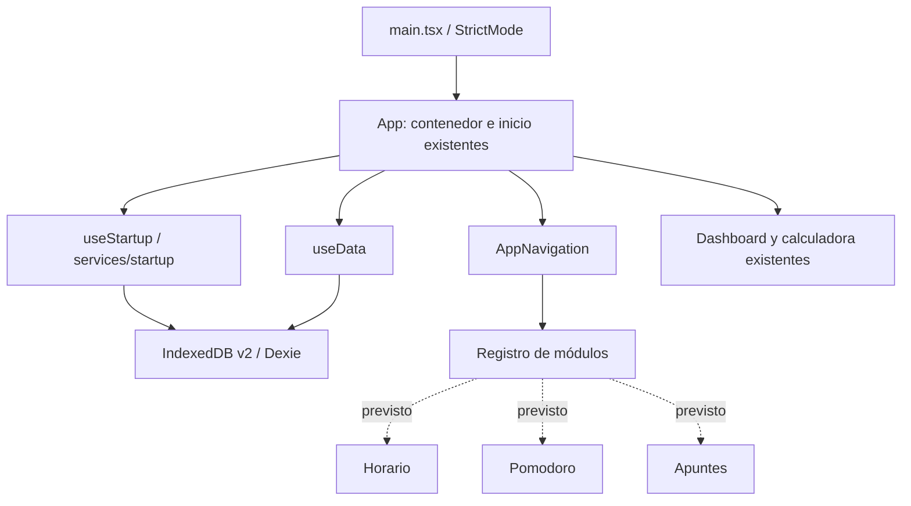

# Etapa 1: base para módulos académicos

## Alcance

Se prepara la integración de Horario universitario, Temporizador Pomodoro y Apuntes por curso. **Ninguno de los tres módulos está implementado ni habilitado.** No hay pantallas vacías, temporizadores simulados, botones futuros sin función ni nuevas tablas de datos en esta etapa.

## Arquitectura encontrada

| Área                      | Estado del checkout inspeccionado                                                                                                                    |
| ------------------------- | ---------------------------------------------------------------------------------------------------------------------------------------------------- |
| Entrada                   | `src/main.tsx` monta `App` con React StrictMode e importa el sistema visual.                                                                         |
| Aplicación                | `App.tsx` contiene el dashboard, estadísticas, edición de cursos, calculadora, respaldos y configuración de tema/mínimo aprobatorio.                 |
| Componentes reutilizables | `GradeCell` administra los campos y eventos de candados; `Modal` proporciona portal, foco y cierre con Escape; `SplashScreen` muestra la bienvenida. |
| Hooks                     | `useStartup` coordina la preparación y los tiempos del splash; `useData` consulta cursos ordenados y configuración con Dexie React Hooks.            |
| Persistencia              | `services/db.ts`: base `MiControlDeNotas`, versión Dexie **2**, almacenes `courses` (`id,order`) y `settings` (`id`).                                |
| Inicio                    | `services/startup.ts` comparte la promesa de preparación y permite reintento. La inicialización existente no sobrescribe bases con configuración.    |
| Modelos                   | `Course`, `Grade`, `Settings`, `Backup` en `types/index.ts`.                                                                                         |
| Utilidades                | `grades.ts`: cálculos, validación de respaldos y CSV. `courseOrder.ts`: normalización y comparación de posiciones.                                   |
| Navegación previa         | Controles de Resumen y Calculadora dentro de `App.tsx`. No había router: Resumen usa `#` y Calculadora abre un modal.                                |
| Recursos                  | Paisaje local `public/aero-landscape.svg`, estilos Aero y animaciones CSS de la bienvenida.                                                          |
| Pruebas                   | Suite de notas, candados, cálculos, persistencia, orden/migración, splash y modales; script de QA del build estático.                                |
| Ejecución                 | Vite para desarrollo/build, frontend estático compatible con Vercel; lanzadores de Windows exclusivos de la ejecución local.                         |

### Diferencia con el contexto multimedia indicado

En este checkout no hay archivos de audio, componentes de reproducción de música ambiental ni un selector de fondos dinámicos. No se incorporan sustitutos ni se crean preferencias de audio. Los recursos visuales presentes se conservan intactos. Si esas funciones están en otra rama o versión publicada, será necesario trabajar con ese código antes de integrarlas en el contenedor común.

## Cambios implementados

| Archivo                                 | Responsabilidad                                                                                                                            |
| --------------------------------------- | ------------------------------------------------------------------------------------------------------------------------------------------ |
| `src/components/AppNavigation.tsx`      | Navegación reutilizable con un landmark accesible. Conserva el enlace Resumen y el callback de Calculadora.                                |
| `src/components/AppNavigation.css`      | Agrupa los controles reutilizando las clases Aero existentes y el espaciado responsive de la barra.                                        |
| `src/modules/registry.ts`               | Registro de módulos con identificadores estables y estados `available` o `planned`; solo los disponibles aparecen en navegación.           |
| `src/types/modules.ts`                  | Contratos de módulos y relaciones por ID de curso. No cambia el modelo de curso existente.                                                 |
| `src/components/AppNavigation.test.tsx` | Regresión de navegación, activación con teclado, callbacks y exclusión de módulos no implementados.                                        |
| `src/App.tsx`                           | Sustituye exclusivamente los controles incrustados de navegación por `AppNavigation`, conservando su acción de apertura de la calculadora. |
| `README.md`                             | Enlace a esta preparación y sus límites.                                                                                                   |

No se añaden dependencias, proveedores globales, servicios CRUD duplicados ni un router. Tampoco se fragmenta todo el dashboard: esa extracción se realizará cuando exista una pantalla nueva real que lo necesite.

## Identidad y relaciones entre cursos y módulos

Un curso utiliza un UUID generado por `crypto.randomUUID()` y persistido en `Course.id`. Sus notas y candados se encuentran en `Course.grades`, un arreglo de cuatro evaluaciones. `order` es una posición de presentación: **no identifica al curso**.

Los contratos nuevos reutilizan la clave mediante `CourseId = Course['id']`. No generan otro ID de curso ni cambian los existentes.

| Contrato                     | Uso futuro                                                                                             |
| ---------------------------- | ------------------------------------------------------------------------------------------------------ |
| `CourseLinkedEntity`         | Entidad con `id` propio y `courseId` obligatorio; base para una entrada de horario o un apunte.        |
| `OptionalCourseLinkedEntity` | Entidad con `id` propio y `courseId: CourseId \| null`; base para una sesión Pomodoro con o sin curso. |
| `AcademicModuleDefinition`   | ID, etiqueta, necesidad de asociación a curso y disponibilidad. Solo los disponibles tienen enlace.    |

Las entidades futuras se relacionarán por `courseId`, nunca por nombre, número de fila o posición. Renombrar o reordenar un curso mantendrá la relación. Cada módulo gestionará su selección de curso de forma independiente; no se reutiliza ni modifica la selección temporal de la calculadora.

### Integridad y eliminación: política prevista

Los futuros servicios deberán comprobar la existencia del curso antes de crear un registro asociado, dentro de una transacción que incluya ambos almacenes. IndexedDB no incorpora claves foráneas automáticas.

Si un curso se elimina posteriormente o no viene en un respaldo, no se borrarán silenciosamente sus apuntes, horarios o sesiones. Se conservarán las referencias y la interfaz del módulo deberá identificar el curso ausente y permitir una resolución explícita. La política de reasociación, archivado o eliminación deberá implementarse junto con cada módulo; no se cambia ahora la eliminación actual de cursos.

## Integración futura

| Módulo                | ID reservado | Relación con curso | Persistencia propuesta, aún no creada                                                                            |
| --------------------- | ------------ | ------------------ | ---------------------------------------------------------------------------------------------------------------- |
| Notas actuales        | `grades`     | Curso existente    | `courses` y `settings` actuales.                                                                                 |
| Horario universitario | `schedule`   | Obligatoria        | `scheduleEntries`: ID propio e índice `courseId`; campos de día y horario se definirán al implementar el módulo. |
| Temporizador Pomodoro | `pomodoro`   | Opcional           | `pomodoroSessions`: ID propio, `courseId` nullable e instante de inicio.                                         |
| Apuntes por curso     | `notes`      | Obligatoria        | `courseNotes`: ID propio, `courseId` e instante de actualización.                                                |

Para activar cada módulo:

1. Implementar su vista, hook y servicio siguiendo las carpetas actuales, sin escribir desde el registro de navegación.
2. Reutilizar `getOrderedCourses`, `Course.id`, `Modal`, las clases Aero y las consultas reactivas existentes.
3. Añadir únicamente la migración necesaria para sus datos y probarla contra una base anterior con notas y candados.
4. Incorporar la selección de vista sin desmontar el contenedor de inicio, la bienvenida ni futuros controladores multimedia/Pomodoro. Cambiar de sección no debe volver a ejecutar la carga artificial.
5. Registrar el enlace del módulo y cambiarlo de `planned` a `available` solo cuando la vista y sus acciones estén implementadas.
6. Extender la cobertura de navegación, datos, respaldos, offline y responsive antes de publicarlo.

La calculadora continúa siendo una acción que abre un modal, no un módulo nuevo ni una ruta. La navegación preparada usa enlaces hash: una integración futura puede mantenerlos para evitar rutas de servidor o reglas adicionales en Vercel.

## Persistencia y migraciones futuras

**Esta etapa no cambia IndexedDB v2, no abre tablas nuevas y no ejecuta una migración adicional.** Tampoco cambia la inicialización ni los datos predeterminados.

Una secuencia posible, dependiente del orden real de implementación, es:

| Versión propuesta | Cambio aditivo                                              |
| ----------------- | ----------------------------------------------------------- |
| v3                | Crear `scheduleEntries` con índice `courseId`.              |
| v4                | Crear `pomodoroSessions` con índices `courseId` e inicio.   |
| v5                | Crear `courseNotes` con índices `courseId` y actualización. |

Estas versiones son un plan, no esquemas activos ni compromisos de nombres definitivos. Cada versión conservará las declaraciones anteriores y no eliminará ni recreará `courses` o `settings`. No requiere recorrer o reescribir notas para crear tablas independientes.

Las preferencias de los módulos se añadirán solo cuando se necesiten, mediante un almacén separado o actualizaciones parciales. No se utilizará un `put` de configuración global que descarte el tema, el mínimo aprobatorio u otras preferencias presentes en versiones futuras.

## Compatibilidad de respaldos

El formato actual **JSON versión 1** y sus validaciones permanecen sin cambios. Se siguen aceptando los respaldos antiguos sin posición de curso mediante la compatibilidad ya existente.

Antes de guardar datos de un módulo nuevo deberá definirse una versión ampliada de respaldo que los incluya y que siga leyendo JSON v1. La importación de un respaldo antiguo no debe interpretarse como una orden de vaciar almacenes nuevos. Si se reemplazan los cursos, las referencias que queden sin curso deberán conservarse y señalarse, sin reasignarlas por nombre.

Una restauración completa futura requerirá validación de IDs y relaciones, resumen de lo que se sustituye, confirmación explícita y transacciones sobre todos los almacenes afectados. Nada de ese nuevo comportamiento se implementa en esta etapa.

## Offline, recursos y Vercel

La nueva navegación y los contratos son locales: no hay API remota, backend, variables de entorno ni dependencias de los lanzadores de Windows en producción. Las futuras vistas podrán usar Dexie y recursos incluidos en el bundle o `public/`, sin depender de servicios en internet.

Se comprobó que, **después de cargar el build**, Resumen y Calculadora funcionan con la red desactivada y conservan los datos. Esto no equivale a garantizar una apertura nueva sin red desde Vercel: actualmente no hay un service worker/PWA que garantice el arranque en frío offline. La caché de aplicación y sus actualizaciones serán una decisión independiente si se requiere ese comportamiento. Los tres módulos aún no existen y su funcionamiento offline completo deberá verificarse al implementarlos.

No se modifica la configuración de Vite ni el despliegue de Vercel. No se requieren variables de entorno para esta etapa.

## Verificación realizada

- Suite automatizada: **38 pruebas aprobadas** (35 existentes y tres nuevas).
- `npm run build`: TypeScript y compilación de producción correctos.
- QA sobre `dist/` con Chrome en perfil temporal aislado: 24 combinaciones de resolución/zoom equivalente mediante el script existente de tabla; sin desbordamiento global, desalineación o cambios en la asociación de notas/candados.
- Comprobación adicional del nuevo landmark de navegación: solo Resumen y Calculadora visibles; apertura de calculadora, cierre por Escape y vuelta a Resumen sin repetir splash.
- Red desactivada tras la carga: la navegación y el modal funcionan; comparación completa de IndexedDB antes y después confirma cursos, posiciones, notas, candados y configuración sin cambios.
- Sin excepciones JavaScript ni dependencias de recursos externos de la aplicación durante esas comprobaciones.
- Comparación SHA-256 de los archivos de persistencia, cálculos, modelos actuales, orden, hooks de datos/inicio, campos de notas, modal, splash, estilos globales, paisaje, configuración y dependencias: intactos.

Las pruebas de base de datos y navegador utilizan datos aislados; no se accedió al perfil habitual del usuario ni al sitio desplegado. La existencia de música o fondos adicionales en otra rama o despliegue no se pudo comprobar con este checkout.

No se realizó `git push` ni un despliegue en Vercel.
